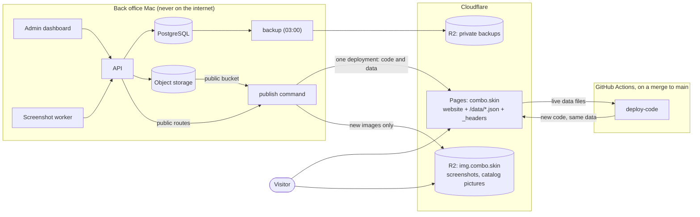

# Static publishing

How Combo Skin is put on the internet, and why. The specs are [021](specs/021-serverless-publish.md) (publishing) and [026](specs/026-deploy-on-merge.md) (merge deploys); the commands and runbooks are in [`deploy/README.md`](../deploy/README.md).

## The decision

The public site is static files on Cloudflare: the website and its combo data on Pages at `combo.skin`, the screenshots and catalog pictures in an R2 bucket at `img.combo.skin`. The back office (admin dashboard, API, PostgreSQL, object storage and the screenshot worker) stays on one Mac and is never reachable from the internet. A publish command on that Mac turns the published combos into the next deployment. Code changes also go live by themselves: on every merge to `main`, GitHub Actions builds the website at that commit with the data the live deployment already serves, so combos still change only with a publish.

The earlier plan was a small server running the API, with the dashboard behind Cloudflare Access on `admin` and `api` subdomains. It was dropped on 12 November.

## What runs where

A visitor's browser talks to Cloudflare only. The Mac talks to Cloudflare only when the owner publishes, and at night for the backup. A merge deploy reads the live data from the site itself, like a visitor, and never reaches the Mac or the image bucket.

## Why static beat a server

- **Nothing to break or attack.** Visitors only read. Every page is the same for everyone, so a file on a CDN answers it as well as a server would, from close to the visitor, with no process to crash, patch or scale, and no database reachable from outside.
- **The back office stays private.** The dashboard, API and database never face the internet: no login page to brute-force, no Access rules to get right, no exposed admin routes.
- **Code and data move together.** One deployment holds the website and the data it was built for. A rollback restores both. A failed publish leaves the live site as it was, because production only changes after the preview of the same folder passes its smoke test.
- **Cost.** About €0 a month on Cloudflare's free plan (below), instead of a server and its upkeep.
- **Same page code.** The site reads `/data/...` files with the same types it read from the API, so the pages barely changed.

## Trade-offs accepted

- **Combos are not live until a publish.** A combo published in the dashboard reaches the site on the next run of the command. A merge to `main` goes live by itself minutes later, on the live data, unless it needs data in a new shape, which then waits for a publish. `status` says how far behind the live site is and whether the next merge deploy can go out.
- **A rollback pauses merge deploys.** After a rollback in the dashboard, merges stop going live by themselves until the next publish, so `main` can't put rolled-back code or data straight back. A run of the workflow by hand on `main` deploys anyway, when only the code was rolled back.
- **CI holds a deploy token.** The merge deploy job has a Cloudflare token limited to Pages on one account, in a GitHub environment that only `main` can use, on a machine that never installs the website's npm packages.
- **The Mac is a single point.** Publishing needs the Mac and its local stack. If the Mac is lost, the live site keeps running from Cloudflare; the database comes back from the off-Mac backup, and screenshots and pictures can be made again.
- **No visitor input yet.** Votes, logins and anything else that sends data back need a backend; see Later.
- **Deleted images linger for a while.** Images of removed combos stay in the bucket for 30 days so a rollback still finds them, unless removed at once with `prune-images --now`.
- **Previews are public.** `pages.dev` addresses can be reached by anyone with the link, though they carry `noindex`.

## Free-tier numbers

From Cloudflare's docs, checked 22 November, at about 2,000 combos and the catalog's 670 finishes:

| Limit (free plan) | Value | Our use |
| --- | --- | --- |
| Pages files per deploy | 20,000 | About 720 now (670 finish files, counts, built files, headers); about 1,425 with spec 022's pages |
| Pages file size | 25 MiB | Largest about 300 KB (the catalog chunk) |
| `_headers` rules / line length | 100 / 2,000 characters | 5 rules; the CSP line is about 420 characters |
| Pages static requests and bandwidth | Unlimited | All site traffic |
| Pages builds | 500 a month | None: the site is uploaded, not built by Pages |
| R2 storage | 10 GB-month | About 0.5 GB of screenshots and pictures, backups well under 0.1 GB |
| R2 Class A operations (writes, lists) | 1 million a month | About 7,300 uploads once, then new images and a few listings per publish |
| R2 Class B operations (reads) | 10 million a month | Only cache misses on `img.combo.skin` |
| R2 egress | Free | |

On 22 November the owner's local data was 302 published combos: 671 data files (about 1.2 MB, the largest 85 KB), 1,639 images (about 146 MB) and 782 files in the deploy (about 5.7 MB).

## Later: visitor features

The site stays static. When visitors need to send something back (votes, Steam login, view counts), a Cloudflare Worker can take a path such as `/api/*` on the same origin, through Pages Functions or a route on the zone, with D1 for data or Analytics Engine for counts. The CSP's `connect-src 'self'` already allows same-origin calls, so the pages could call it without a new origin or CORS. Nothing in this setup has to be undone for that.
