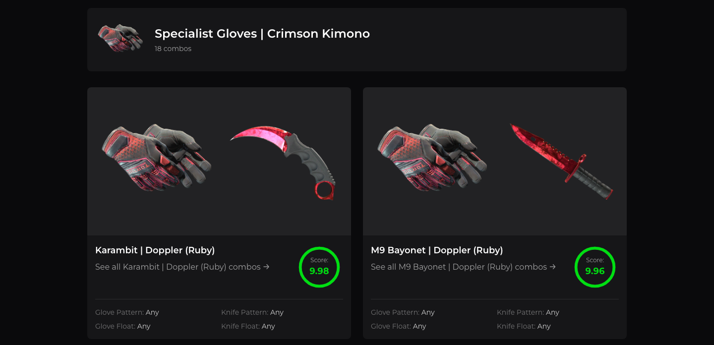

# Combo Skin website

[](https://github.com/shb327/combo-skin/actions/workflows/website.yml)

Combo Skin helps CS2 players find good-looking glove and knife combinations, for themselves or for a friend.

## What the site does

In Counter-Strike 2, players equip cosmetic gloves and knives, each available in many finishes. Picking a pair that looks good together is hard when there are hundreds of options. Today a visitor can:

- **Browse gloves**: pick one of 8 glove types, then one of its finishes (72 in total).
- **Browse knives**: pick one of 20 knife types, then one of its finishes (576 in total).
- **See combos for a glove finish**: in-game screenshots of that glove paired with a knife, each with a rating, a short description and, where it matters, the pattern seed or float.
- **Search** gloves and knives by name from the top bar.

Combos are curated by hand and currently exist for a few glove finishes. Combos listed from the knife side (which gloves suit a given knife) are not implemented yet.

## Screenshots




## Getting started

Prerequisites: [Node.js](https://nodejs.org/) 24 and [npm](https://docs.npmjs.com/) 11.

```bash
cd website
npm ci
cp .env.example .env   # then set VITE_ASSET_BASE_URL, see Configuration
npm run dev
```

Open the local address Vite prints (port 5173 by default). The site runs without a `.env` file, but finish images will not load.

## Scripts

| Command | What it does |
| --- | --- |
| `npm run dev` | Starts the [Vite](https://vite.dev/) dev server with hot reload. |
| `npm run build` | Type-checks (`tsc -b`) and builds the production bundle into `dist/`. |
| `npm run lint` | Runs ESLint over the project. |
| `npm run preview` | Serves the production build from `dist/` locally. |

CI runs `npm ci`, `npm run lint` and `npm run build` on every push and pull request.

## Configuration

The site reads one variable from `website/.env` (see [`.env.example`](.env.example)):

| Variable | Example | Meaning |
| --- | --- | --- |
| `VITE_ASSET_BASE_URL` | `https://your-minio-server.example.com/bucket` | Base URL of the server that hosts finish images. |

Finish images are loaded from `<VITE_ASSET_BASE_URL>/gloves/<glove-type>/<finish>.png` and `<VITE_ASSET_BASE_URL>/knives/<knife-type>/<finish>.png`. Without a real value the site still works, but finish images do not load. Glove and knife type images, combo screenshots and the home page artwork are stored in the repository, imported in code and bundled by the build, so they always load.

`VITE_` variables are built into the client bundle, so never put a secret in `.env`.

## Project structure

| Path | Contents |
| --- | --- |
| `src/pages/` | One component per route: `Home`, `SearchGloves`, `GloveFinishes`, `SearchKnives`, `KnifeFinishes`, `Combos`. Routes are defined in `src/App.tsx`. |
| `src/components/` | Shared UI: app bar with search, hero, item cards, footer. |
| `src/data/` | The site's content as typed TypeScript: glove types, knife types, finishes and combos. |
| `src/assets/` | Images bundled with the site: logos, glove and knife type images, combo screenshots. |
| `CS2_FINISHES.md` | Why knife finish counts differ between knives in CS2. |

The `@` import alias points to `src/`.

## Data

All content lives in `src/data/`. There is no backend yet.

**Add a glove finish.** In `src/data/gloves.ts`, add `{ id, name }` to the glove type's `finishes`. The `id` is kebab-case and must match the image file name on the asset server: `gloves/<glove-type>/<id>.png`.

**Add a knife finish.** Knives share finish lists by tier in `src/data/knives.ts` (see `CS2_FINISHES.md`): `baseFinishes` for every knife, `tier2Finishes` for newer knives, `tier1Finishes` for the original knives. Add the finish to the tier where it belongs; each knife type in `knifeTypes` points at one tier. The image goes at `knives/<knife-type>/<id>.png` on the asset server.

**Add a combo.** Put the screenshot in `src/assets/combos/<finish>/`, then in `src/data/combos.ts` import it at the top of the file:

```ts
import mogul5 from '@/assets/combos/mogul/5.jpeg'
```

Find the `gloveCombos` entry for the glove type and finish (or add one with `gloveTypeId` and `gloveFinishId`), and add a combo to its `combos`, using the import as the image:

```ts
{
  id: 'mogul-5',
  image: mogul5,
  knifeId: '',
  knifeName: 'Karambit | Doppler (Ruby)',
  rating: 8.5,
  description: 'A short note on why the pair works.',
  knifePattern: '412', // optional; also glovePattern, gloveFloat, knifeFloat
}
```

Always import images: a string path such as `'/src/...'` works on the dev server but is missing from the build, and CI fails the build check if one slips in. The `Combos` page lists every combo for the glove finish in the URL.
