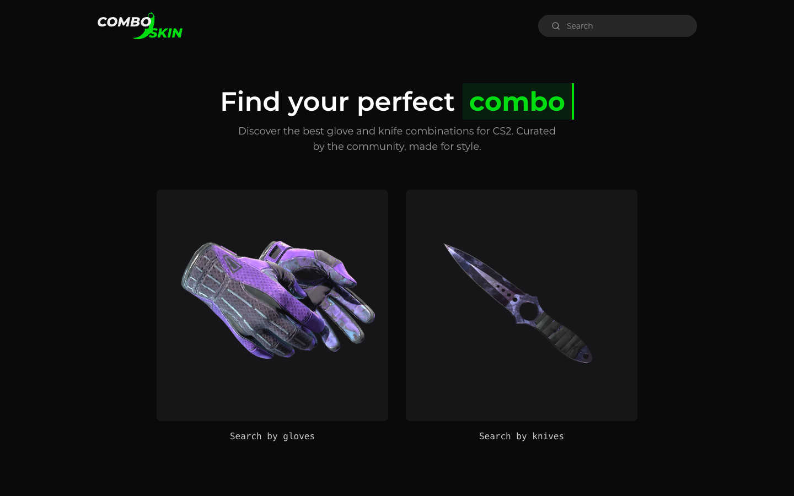
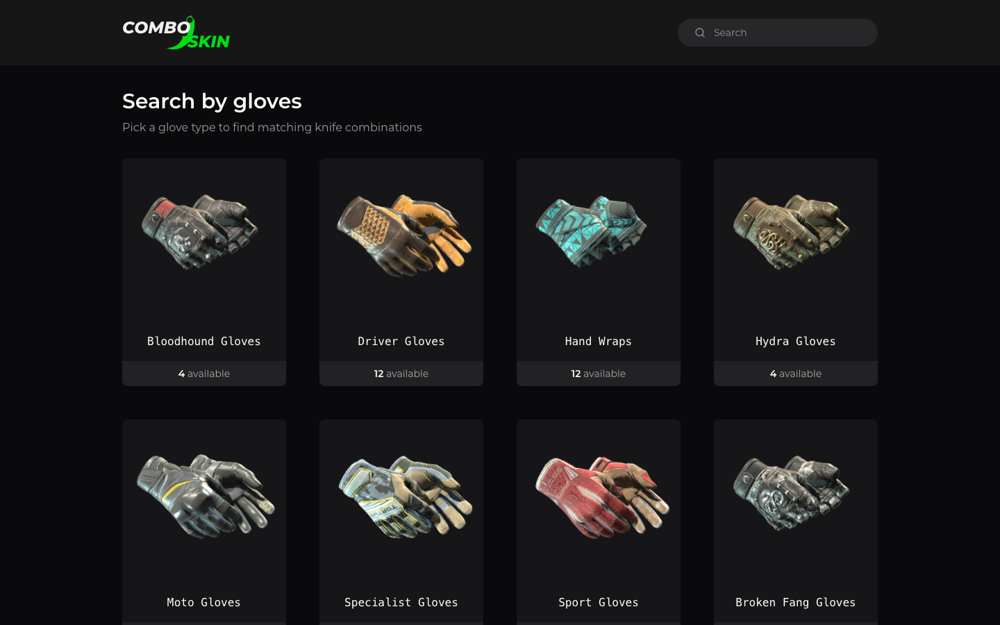

# Combo Skin website

[](https://github.com/shb327/combo-skin/actions/workflows/website.yml)

Combo Skin helps CS2 players find good-looking glove and knife combinations, for themselves or for a friend.

## What the site does

In Counter-Strike 2, players equip cosmetic gloves and knives, each available in many finishes. Picking a pair that looks good together is hard when there are hundreds of options. Today a visitor can:

- **Browse gloves**: pick one of 8 glove types, then one of its finishes (94 in total).
- **Browse knives**: pick one of 20 knife types, then one of its finishes (576 in total).
- **See where the combos are before clicking**: type cards show how many combos each type has, finish cards how many each finish has, and a "Has combos" filter hides the finishes without any. The filter is kept in the page's URL (`?has=combos`), so a shared link keeps it.
- **See combos for a glove or knife finish**: the knives that suit a glove finish, or the gloves that suit a knife finish, best rated first, each with a rating, both finish pictures, the pattern seeds and float ranges that suit it ("Any" where any will do), and sometimes a short description.
- **View a combo in 3D**: "View in 3D" on a card opens the combo in first person in a window over the page, with the game's inspect and knife swings and a choice of map and agent (see View in 3D).
- **Search** gloves and knives by name from the top bar.

Combos come from the Combo Skin API ([`api/`](../api/README.md)): they are entered in the admin dashboard, and only published combos are shown. Each card shows the combo's in-game screenshot, drawn by a screenshot worker and watermarked by the API; a combo without one yet, or whose screenshot fails to load, shows the catalog pictures of its gloves and knife instead.

## View in 3D

Each combo card has a "View in 3D" button in the top-right corner of its screenshot, in white at about 60% opacity like the screenshots' watermark. It shows only in browsers with WebGL2, checked once per page load with a canvas that is released at once. Nothing of the viewer loads until a click; the window's own code and the agent list (`src/data/agents.json`) load from the site on the first click.

- **The window.** The click opens a modal window over the page (a `<dialog>`): the page behind is dimmed, cannot be reached, and does not scroll. The window shows the combo's name and rating, the 3D view (an iframe from `VITE_VIEWER_ORIGIN`), the game's actions, the map and agent choices, "Copy link", "Full screen" (on the whole window, where the browser allows it) and "Close". The card keeps its screenshot.
- **Layouts.** On a screen 768 px wide and 500 px tall or more, the view is 16:9, as large as fits (at most 1600 px wide). On a phone the window fills the screen: the name row on top, the view filling the space, the controls at the bottom with buttons at least 44 px tall; on a phone held sideways the name row goes and Close sits over the view.
- **Loading.** The combo's screenshot shows where the view will be, with "Loading 3D view…" and a progress bar, until the viewer reports the combo drawn; then it fades out over 200 ms (at once when the browser asks for reduced motion).
- **Actions and keys.** "Inspect" (F), "Light swing" (left click) and "Heavy swing" (right click), each with its key shown (not on touch-first devices). The buttons send the action to the viewer; F works with focus on the window's controls (not while typing in the agent search). Inside the view the viewer itself plays them on F and on the mouse buttons (`input=game`), and the mouse never turns the camera. Each control shows only when the viewer can play it for the knife drawn.
- **Map and agent.** "Map" lists exactly the maps the viewer reports (Vertigo today), never the plain studio. "Agent" lists the agents the viewer has built that `src/data/agents.json` names, with their pictures: "Default (Lt. Commander Ricksaw | NSWC SEAL)" first, then Counter-Terrorists and Terrorists, each by name, searchable by any word. A change reloads the same combo in the same iframe over the last frame. A map or agent the viewer refuses falls back to the default with a short note. The choice is remembered for the visit, in memory: the next window opens with it, and a reload starts from the defaults.
- **The address.** Opening adds `?3d=<combo id>` to the page's address as a history entry, so Back closes the window, and "Copy link" copies it. A page opened with it shows the window with the screenshot and "Load 3D view": nothing 3D loads before that click. An id the page does not list is dropped.
- **What is drawn.** Both items by the game's definition and paint index (from the API's combo items), with the float and seed the card's screenshot is drawn with: the start of the combo's float range, else the finish's lowest float, and the combo's lowest seed, else no seed (the viewer then draws its default, as it does for the screenshot). A vanilla knife has neither. The default map and agent are not sent; a chosen one is. The combo's own screenshot agent is never used.
- **Closing.** "Close", Escape (also from inside the view, which the viewer forwards), Back, or leaving the page removes the iframe (pointed at `about:blank` first), frees its memory, and returns focus to the card's "View in 3D". In full screen the browser's Escape leaves full screen first; with the agent list open, Escape closes the list.
- **Phones.** On a screen under 768 px wide, a touch-first device or a browser asking to save data, the first window of a visit says the view downloads about 34 MB, with "Load 3D view" and "Cancel".
- **Errors.** Any viewer error, or no answer within 15 seconds (or no news for 60 seconds while loading, a change of map or agent included), removes the viewer and shows the screenshot in the window with a short message, and "Try again" when it may help. A failed change that leaves the last scene on screen only says so, with "Try again". A browser without WebGL2 loses the button on every card; a combo the viewer cannot draw loses its own.
- **An older viewer.** The window reads the viewer's protocol version and features from its first message. A viewer of protocol version 1 gets the view, "Inspect", "Full screen" and "Close": no swings, map or agent choice.
- **Messages.** The page accepts the viewer's events only from `VITE_VIEWER_ORIGIN` and only from the open iframe, posts to it only with that origin as the target, and never shows the viewer's own message text; map names, the only text from the viewer it shows, are checked and shown as plain text. The iframe is sandboxed (`allow-scripts allow-same-origin`) and keeps the default referrer policy, which the viewer needs to know its parent.
- **Nothing stored.** Nothing about 3D views or the visitor's choices is stored in the browser or sent anywhere by the page.

The viewer and its message contract live in their own public repository; see its [`docs/embed.md`](https://github.com/shb327/cs2-combo-viewer/blob/main/docs/embed.md). The hosted viewer accepts this site's dev and preview servers (ports 5173 and 4173), so it can be used in development by setting `VITE_VIEWER_ORIGIN` in `website/.env`.

## Screenshots






## Getting started

Prerequisites: [Node.js](https://nodejs.org/) 24 and [npm](https://docs.npmjs.com/) 11.

```bash
cd website
npm ci
npm run dev
```

Open the local address Vite prints (port 5173 by default). No `.env` file is needed; see Configuration for the optional settings.

Combos pages read the API at `http://localhost:8000` by default. To see combos, start the API with Docker Compose as described in [`api/README.md`](../api/README.md); combos appear once they are published in the admin dashboard. Without the API, every other page works, type and finish cards show no combo counts and no filter, and a combos page says "Combos could not be loaded." with a "Try again" button.

## Scripts

| Command | What it does |
| --- | --- |
| `npm run dev` | Starts the [Vite](https://vite.dev/) dev server with hot reload. |
| `npm run build` | Type-checks (`tsc -b`) and builds the production bundle into `dist/`. |
| `npm run lint` | Runs ESLint over the project. |
| `npm test` | Runs the tests with [Vitest](https://vitest.dev/), against a fake API. |
| `npm run preview` | Serves the production build from `dist/` locally. |
| `npm run api:types` | Regenerates `src/api/schema.d.ts` from `../api/openapi.json`. Run it after the API's OpenAPI snapshot changes. |
| `npm run api:types:check` | Exits 1 if `src/api/schema.d.ts` is out of date. |

CI runs `npm ci`, `npm run api:types:check`, `npm run lint`, `npm test` and `npm run build` on every push and pull request.

## Configuration

Optional settings live in `website/.env`, which is never committed (see [`.env.example`](.env.example)):

| Variable | Example | Meaning |
| --- | --- | --- |
| `VITE_API_BASE_URL` | `https://api.example.com` | Optional. The API's origin; `http://localhost:8000` when unset. Exactly an origin: `http` or `https`, a host and an optional port, with no path, trailing slash, query or user info; plain `http` only for `localhost`. Any other value stops the dev server and the build with an error naming the variable. |
| `VITE_IMAGE_ORIGIN` | `https://images.example.com` | Optional. Where combo screenshots load from: the API's public image bucket, `http://localhost:9000` (the local storage service of the Compose stack) when unset. The same rules as `VITE_API_BASE_URL`; an invalid value stops the dev server and the build with an error naming the variable. |
| `VITE_VIEWER_ORIGIN` | `https://viewer.example.com` | Optional. The 3D viewer's origin for "View in 3D"; `http://127.0.0.1:5321` (the viewer's local production build, `vite preview` in the viewer project) when unset. The same rules as `VITE_API_BASE_URL`, except that plain `http` is also allowed for `127.0.0.1`; an invalid value stops the dev server and the build with an error naming the variable. Production sets the hosted viewer. |
| `DEV_ALLOWED_HOSTS` | `tunnel.example.com` | Optional. Comma-separated extra hosts the dev server accepts, for example a tunnel to your machine. Dev server only. |

Finish images load from Steam's image servers, using the URLs in `src/data/catalog.json` (see Data); the browser sends them no referrer. Combo cards show the combo's screenshot: an `img` with a `srcset` of its three WebP versions (640, 1280 and 1920 pixels wide), `sizes="(min-width: 1024px) 50vw, 100vw"` to match the one- and two-column layouts, a fixed width and height so nothing shifts while it loads, lazy loading and no referrer. Screenshots load only from `VITE_IMAGE_ORIGIN`; a URL on any other host, a combo without a screenshot, or an image that fails to load shows the catalog pictures, from the URLs in the API's answer and only from Steam's image host. Glove and knife type images and the home page artwork are stored in the repository, imported in code and bundled by the build.

The API answers the site's requests from any origin (see Public CORS in [`api/README.md`](../api/README.md)); the site sends them without cookies.

`VITE_` variables, including `VITE_API_BASE_URL`, are built into the client bundle, so never put a secret in `.env`.

To reach the dev server through a tunnel, add the tunnel's host to `website/.env` and restart `npm run dev`:

```bash
DEV_ALLOWED_HOSTS=tunnel.example.com
```

Without it, Vite answers requests for any other host with 403. `DEV_ALLOWED_HOSTS` has no `VITE_` prefix, so it never reaches the browser bundle. Keep real tunnel hosts in `.env` only, never in committed files.

## Project structure

| Path | Contents |
| --- | --- |
| `src/pages/` | One component per route: `Home`, `SearchGloves`, `GloveFinishes`, `SearchKnives`, `KnifeFinishes`, `Combos`. Routes are defined in `src/App.tsx`. |
| `src/components/` | Shared UI: app bar with search, hero, item cards, footer. |
| `src/viewer/` | "View in 3D": the viewer's address and load fields for a combo (`params.ts`), its events and the page's error text (`messages.ts`), what the viewer can do (`features.ts`), the agents to choose from (`agents.ts`), the WebGL2 and data-saving checks (`webgl.ts`), the open window and the visit's flags and choice (`state.ts`), the window's address and opening (`ViewerHost.tsx`, `open.ts`), the window (`ViewerWindow.tsx`), its controls (`ViewerControls.tsx`) and the iframe (`ComboViewer.tsx`). The card's box with its button is `src/components/ComboPictures.tsx`. |
| `src/api/` | The API client (`client.ts`, the only module that makes requests), its types generated from the OpenAPI snapshot (`schema.d.ts`), the combos and counts queries (`queries.ts`, with the count helpers in `counts.ts`), and the API origin, image origin, picture and screenshot host rules. |
| `src/data/` | The generated knife and glove catalog (`catalog.json`, read by `gloves.ts` and `knives.ts`) and agent list (`agents.json`, read by `src/viewer/agents.ts`). |
| `src/assets/` | Images bundled with the site: logos, glove and knife type images, the home page artwork (`hero/`). |
| `src/test/` | Test helpers: the fake API, a fake viewer (`viewer.ts`) and a renderer for the whole site. Tests sit next to the code as `*.test.ts(x)`. |
| `CS2_FINISHES.md` | Why knife finish counts differ between knives in CS2. |

The `@` import alias points to `src/`.

## Data

**Knife and glove finishes** come from `catalog.json`: every knife and glove type in CS2 and every finish it can have, with its display name and a Steam image URL. It is generated from the game's item data by the API's catalog tooling, so never edit it by hand. To change the catalog, or the order types and finishes are shown in, see the Catalog section of [`api/README.md`](../api/README.md). The data comes from [ByMykel/CSGO-API](https://github.com/ByMykel/CSGO-API) under the MIT licence; see [`THIRD_PARTY_NOTICES.md`](../THIRD_PARTY_NOTICES.md).

Type and finish slugs (`bloodhound`, `doppler-phase-2`) are the ones in the site's URLs, and they never change once assigned.

**Agents** come from `agents.json`, generated by the same tooling from the same data: each agent's definition index, name, team and Steam image URL, Counter-Terrorists first, then Terrorists, each by name. Only the 3D window uses it, to name and picture the agents the viewer can draw; it is in the window's own chunk. Never edit it by hand either.

**Combos** are not in the repository. The combos pages ask the API for the published combos of their finish (`GET /gloves/{type}/{finish}/combos`, `GET /knives/{type}/{finish}/combos`) and show them in the order the API returns: highest rating first. The type and finish pages ask once for every finish's count (`GET /combo-counts`) and keep it for 5 minutes, like the combos; when a combos page loads, its finish's count is updated to match. Combos are added, rated and published in the admin dashboard ([`admin/`](../admin/README.md)).
